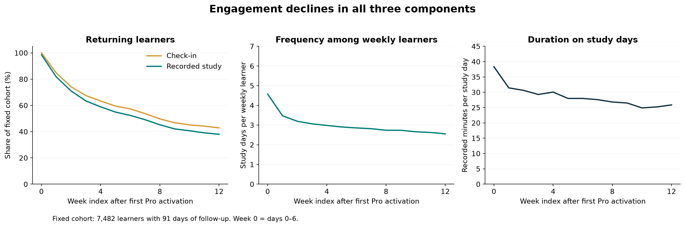

# The Coach paid learner engagement

An analysis of how paid learners accumulate recorded study time after their first Pro activation. The project examines the 20-hour first-month target, longer-term accumulation, retention and module usage. Product solutions are outside the current scope.

**Author:** My prodcut team, consist of 5 members. My role is Data Analyst - **Tools:** SQL, Python, Power BI  
**Dataset:** 13,462 paid users and 413,598 daily records, observed through 24 June 2024.

Developed from my data analysis work in my team at Product Pioneer Candidate 2024. This portfolio extension revisits the measurement approach and adds reproducible SQL and Python analysis.

## Findings

- 702 of 12,851 eligible learners reached 20 recorded study hours in their first 30 days (5.46%); median accumulation was 4.12 hours.
- In a fixed cohort of 7,482 learners, weekly learning participation declined from 98.60% in week 0 to 38.00% in week 12. Frequency and duration also declined.
- Onion reached 93.74% of 30-day-eligible learners; 89.12% of its adopters used it on at least two days. Low total time should not be equated with low adoption.
- Learning on 5–7 days in the first week was associated with 54.15% week 8 participation. This is observational, not evidence of a causal habit threshold.



*Python-generated figure. The interactive Power BI report is included separately below.*

## Explore this project

| What you want to see | Start here |
| --- | --- |
| Findings and their interpretation | [Analysis report - Vietnamese](reports/INSIGHTS_VI.md) |
| Interactive dashboard | [Power BI setup guide](powerbi/README.md) - [Download the project](powerbi/TheCoach.pbip) |
| How the analysis was designed | [Analysis plan - Vietnamese](docs/ANALYSIS_PLAN_VI.md) - [Metric definitions](docs/METRICS.md) |
| SQL skills | [Pipeline walkthrough](sql/README.md) - [SQL code](sql/01_pipeline.sql) |
| Python skills | [Data pipeline](src/analyze.py) - [Extended analysis](src/extended_analysis.py) - [Charts](src/plot_results.py) |

To open Power BI, download or clone the **whole repository**, not just the `.pbip` file. The report and model folders are required. Included aggregate CSVs let you explore the dashboard without access to the original data.

## Business question

How many paid learners reach 20 recorded study hours in their first 30 days, and how do return frequency and study duration evolve after activation?

The competition brief also specifies 100 hours over four to five months. This analysis operationalizes those windows as 120 and 150 days and reports eligible populations separately.

## Tools and evidence

| Tool | Responsibility |
| --- | --- |
| SQL / DuckDB | Type validation, joins, observation windows, cohort aggregation, cumulative metrics and consecutive-day streaks |
| Python / pandas | Source ingestion, independent user-level reconciliation and reproducible aggregate exports |
| Power BI | Power Query CSV imports, dimensional relationships, guarded DAX measures and three interactive report pages |

## Repository layout

```text
README.md          Project overview and reading guide
docs/              Analysis plan and metric definitions
reports/           Findings, figures and validation evidence
powerbi/           Editable report, semantic model and setup guide
sql/               SQL transformation and analysis pipeline
src/               Python analysis and visualization
data/processed/    Aggregate CSVs used by Power BI
tests/             Data-quality and observation-window tests
scripts/           Validation and packaging utilities
```

Validation JSON files and `COMPLETION_AUDIT.md` are supporting evidence; start with the findings report for the main narrative.

## Reproduce

Rebuilding the analysis requires authorized access to the original CSVs. To view the dashboard only, skip this section and follow the Power BI instructions below.

Use Python 3.12 or later in a virtual environment, running commands from the repository root:

```sh
python -m pip install -r requirements.txt
python src/analyze.py --input-dir /path/to/authorized/source/files
python src/extended_analysis.py --input-dir /path/to/authorized/source/files
python src/plot_results.py
python -m unittest discover -s tests -v
```

The input folder must contain `paid_user_data.csv` and `paid_user_learning_data.csv`. These competition files are not redistributed. The user CSV is read using cp1258; the learning CSV uses UTF-8. The duplicate day header is renamed explicitly. Validation rejects invalid keys, missing numeric values and negative durations rather than silently converting them to zero.

The runner writes aggregate CSVs to `data/processed/` and verification evidence to `reports/`. Individual-level tables exist only in the in-memory DuckDB session.

## Power BI

Open `powerbi/TheCoach.pbip` in Power BI Desktop with project support enabled. Set the Power Query parameter `DataFolder` to the absolute path of `data/processed/`, then refresh. The pages cover target attainment, weekly retention, and module adoption/repeat usage.

Select one observation period on the goals page. Measures intentionally return blank when different periods would double-count people. Weekly and module totals also require a meaningful single-period/module context. Rates divide summed numerators by summed denominators.

Opening, data loading and all three pages were verified in Power BI Desktop. SQL results were reconciled against independent pandas calculations, and four data-quality/window tests passed. See the [verification record](reports/COMPLETION_AUDIT.md) for scope and limitations.

## Measurement boundaries

- Study hours sum all five module counters, including `other`. Possible counter overlap remains a limitation.
- App hours include non-learning screens and are not substituted for learning hours.
- Only complete observation windows enter denominators. Missing logs within those windows imply inactivity only under a complete-tracking assumption.
- Activation is the earliest Pro activation. Purchase and renewal histories are unavailable.
- Communication lesson counts do not represent all learning in the app.
- Associations are descriptive and do not establish causal effects, learning proficiency or psychological motivation.
- Public aggregate cells require at least ten eligible users; omissions are recorded by the export process.

## Attribution and data access

I contributed data analysis to my team submission for Product Pioneer Candidate 2024 and used Power BI during the competition. This repository is a subsequent portfolio extension with reproducible SQL/Python and revised measurement. It should not be presented as the exact original competition analysis or as a deployed product improvement.

The original PBIX and source data remain outside the public package. No license or permission to redistribute competition data is implied by this repository. Code and methodology can be reviewed independently; reproduction requires authorized access to the source files.
