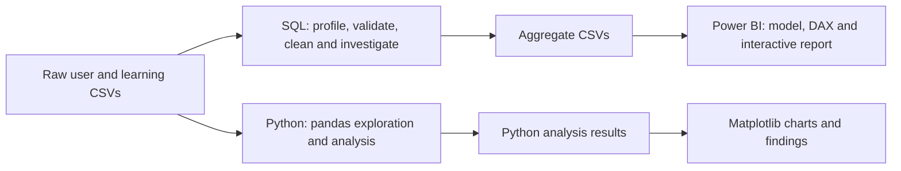

# The Coach - Paid Learner Engagement

An analysis of how paid learners accumulate recorded study time after their first Pro activation. The project examines the 20-hour first-month target, longer-term accumulation, retention and module usage. Product solutions are outside the current scope.

**Author:** My prodcut team, consist of 5 members. My role is Data Analyst - **Tools:** SQL, Python, Power BI  
**Dataset:** 13,462 paid users and 413,598 daily records, observed through 24 June 2024.

Developed from my data analysis work in my team at Product Pioneer Candidate 2024. This portfolio extension revisits the measurement approach and adds reproducible SQL and Python analysis.

## Key findings

- **5.46%** of 12,851 eligible learners reached 20 recorded study hours in their first 30 days. Median accumulation was **4.12 hours**.
- In a fixed cohort of 7,482 learners, weekly learning participation fell from **98.60% to 38.00%** between weeks 0 and 12. Study frequency and duration also declined.
- **93.74%** of 30-day-eligible learners tried Onion GPT; **89.12%** of its adopters returned on at least two distinct days.
- Studying on 5–7 days in the first week was associated with **54.15%** week-8 participation. This is an observational association, not a causal threshold.

[Read the findings in Vietnamese](reports/INSIGHTS_VI.md) - [Metric definitions](docs/METRICS.md) - [Analysis plan](docs/ANALYSIS_PLAN_VI.md)


## Analysis workflow



**SQL + Power BI:** SQL handles source loading, types, quality flags, observation windows and analytical tables. Power BI imports the aggregate CSVs and presents filter-aware measures and three interactive report pages.

**Python:** pandas reads the original CSVs, validates the data and calculates study targets, retention, module usage and sensitivity scenarios. Matplotlib presents the findings in four figures.

Both approaches use the same metric definitions and observation windows. Results are compared to check consistency.

## Where to start

| Folder | Contents |
| --- | --- |
| [sql](sql/README.md) | Ordered SQL files for import, cleaning, investigation and exports |
| [powerbi](powerbi/README.md) | Final PBIX, reusable PBIT and model/dashboard walkthrough |
| [src](src/README.md) | Python analysis and chart code |
| [reports](reports/INSIGHTS_VI.md) | Written findings, Python analysis results and figures |
| [docs](docs/ANALYSIS_PLAN_VI.md) | Analysis plan, metric definitions and verification notes |
| [data](data/README.md) | Local raw sources and aggregate CSV outputs |

## Getting started

### SQL + Power BI

The SQL uses **DuckDB syntax**. From the repository root, open a DuckDB SQL session and run:

```text
.bail on
.read sql/00_import.sql
.read sql/01_pipeline.sql
.read sql/02_export.sql
.read sql/03_investigate.sql
```

The first three files import, process and export data; the fourth contains additional exploratory queries. Use the same session and stop if any validation fails. The encoding extension is installed on first use.

Open [TheCoach.pbix](powerbi/TheCoach.pbix), or start from [TheCoach_template.pbit](powerbi/TheCoach_template.pbit). For the **.pbix** file, should any product source error appears, please open **Home** tab, choose **Transform Data**, **DataFolder** parameter, and paste your own absolute path of `data/processed`, then refresh. (for example, `C:\Users\Nicolas\Documents\the-coach-analytics\data\processed`)
For the **.pbit** file, I already made it to ask for the path right at the start. See the [Power BI walkthrough](powerbi/README.md).

### Python

With Python 3.12+ installed, run from the repository root:

```sh
python -m pip install -r requirements.txt
python src/analyze.py --input-dir data/raw
python src/plot_results.py
```

The analysis writes `reports/extended_analysis.json` and four PNG/SVG figures under `reports/figures`.

## Analytical decisions

- Study time sums five learning-module counters, including `other`; total app time also includes non-learning screens.
- Only fully observable windows enter target and retention denominators. Missing logs within those windows mean no recorded activity, conditional on complete tracking.
- Inconsistent dates, unusually long days and module/app discrepancies are flagged. Primary estimates retain them; sensitivity scenarios show how selected exclusions change results.
- Ratios divide summed numerators by summed denominators. Users cannot be added across modules, weeks or overlapping windows.
- The Python retention figure follows a fixed 91-day cohort; the dashboard also reports week-specific eligible populations. These answer different questions.

## Project context and data access

The author contributed data analysis to the PRODUCKZ submission for Product Pioneer Candidate 2024. This portfolio extends that work through data-quality investigation, cohort analysis, sensitivity checks and an interactive Power BI report.

Raw competition data is kept locally and excluded by `.gitignore`. Reproducing the analysis requires authorized access to both source CSVs.
