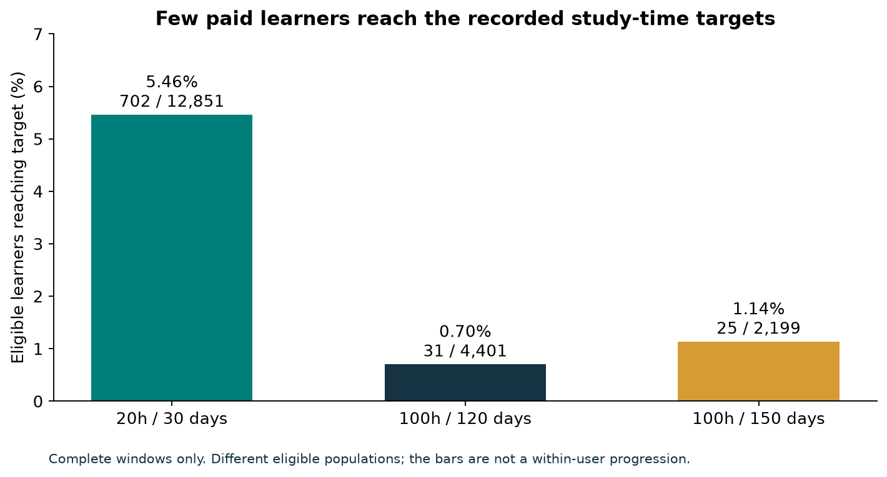
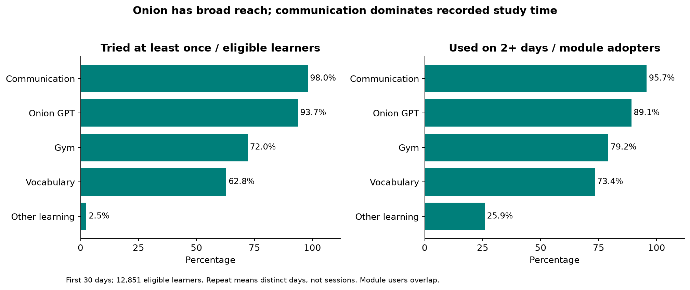
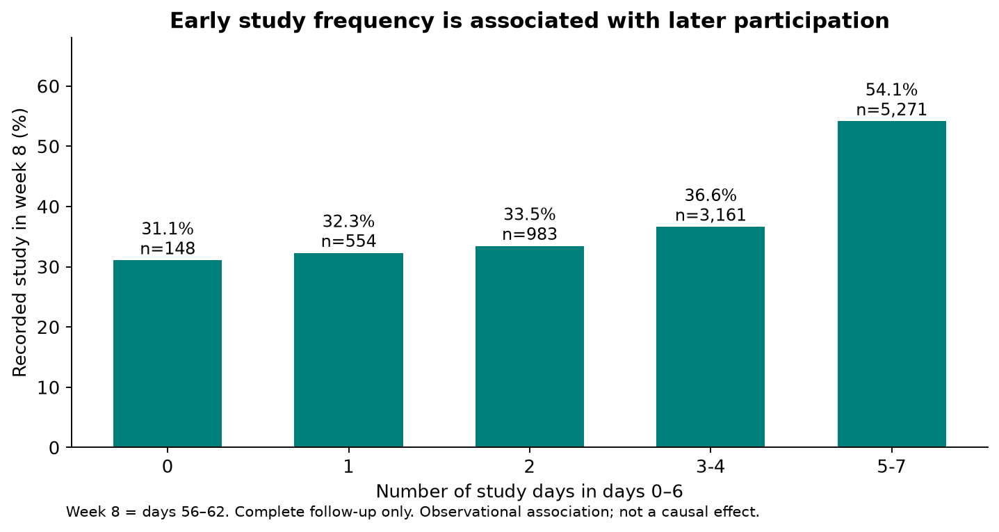

# The Coach - Kết quả phân tích hành vi học tập

Phân tích 13.462 người dùng và 413.598 bản ghi theo ngày, với thời điểm chốt dữ liệu là 24/6/2024. Các kết quả phân tích dưới đây chủ yếu mô tả và diễn giải dữ liệu mô phỏng, không phải cải tiến sản phẩm thực tế. Thời gian học được đo bằng tổng năm bộ module, bao gồm `other`; vẫn có khả năng chồng lấn dữ liệu đếm thời gian, nhưng hạn chế.

## 1. Khoảng cách tới mục tiêu tháng đầu lớn và không chỉ do vài ngày bất thường

Trong 12.851 người có đủ 30 ngày quan sát, 702 người đạt ít nhất 20 giờ học trong app: **5,46%**. Trung bình là 6,63 giờ, trong khi trung vị chỉ 4,12 giờ. Sự chênh lệch cho thấy giá trị trung bình bị kéo lên bởi những người học nhiều; chưa phản ánh sát người dùng điển hình.

Khi bỏ các ngày có thời gian app hoặc tổng module trên 8 giờ, còn 686 người đạt mục tiêu, tương đương 5,34%. Khi bỏ thêm ngày tổng module vượt tổng app, còn 685 người, tương đương 5,33%. Đây là phân tích độ nhạy với cùng mẫu số, không khẳng định các ngày bị bỏ đều sai. Kết luận về mức đạt mục tiêu thấp vẫn giữ nguyên.

Nếu dùng thời gian app thay cho thời gian module, số người được xếp đạt mục tiêu tăng thành 1.026 người, tức 7,98%. Lựa chọn sai chỉ số khiến cho 324 trường hợp đạt theo thời gian app nhưng chưa đạt theo thời gian module.

## 2. Sự suy giảm gồm cả ít người học, ít ngày học và ngày học ngắn hơn

Để tránh thay đổi thành phần mẫu theo tuần, phần này giữ cố định 7482 người có đủ 91 ngày quan sát, kích hoạt chậm nhất 26/3/2024. Tuần 0 là ngày 0–6; tuần 12 là ngày 84–90.

| Chỉ số | Tuần 0 | Tuần 12 |
| --- | ---: | ---: |
| Tỷ lệ có thời gian học được ghi nhận | 98,60% | 38,00% |
| Số ngày học trên một người có học trong tuần | 4,57 | 2,55 |
| Phút học trên một ngày có học | 38,34 | 25,87 |
| Phút học trên một người trong toàn nhóm mỗi ngày | 24,70 | 3,59 |

Chỉ xem thời lượng của người còn học sẽ bỏ qua phần giảm của tỷ lệ quay lại và tần suất. Mức 3,59 phút ở tuần 12 tính cả người không có thời gian học; không phaả là một phiên học chỉ dài 3,59 phút.

Ở tuần 12, 3.207 người có đăng nhập (42,86%), nhưng chỉ 2.843 người có thời gian module dương (38,00%). Cần tách hai chỉ số khi đánh giá duy trì học tập. Không hoạt động trong một tuần cũng chưa chứng minh đã rời app vĩnh viễn.

## 3. Onion có độ tiếp cận rộng; thời lượng thấp hơn Learn không đồng nghĩa ít người thử

Trong 12.851 người đủ tháng đầu, 12.046 người dùng Onion ít nhất một ngày (93,74%). Trong số người đã dùng, 10.735 người dùng ở ít nhất hai ngày (89,12%). Onion chiếm khoảng 20,25% tổng thời gian module, còn lộ trình giao tiếp chiếm 54,17%.

Vì vậy, nhận định “Onion ít được sử dụng” cần được giới hạn theo chỉ số. Dữ liệu cho thấy phần lớn người dùng đã tiếp cận Onion; chưa chứng minh họ thấy tính năng hấp dẫn, sử dụng hiệu quả hoặc đạt năng lực giao tiếp tốt hơn. “Dùng lại” ở đây là nhiều ngày khác nhau, không phải số phiên hoặc chuỗi ngày liên tục.

## 4. Học đều trong tuần đầu liên hệ với khả năng quay lại sau này

Trong 10.117 người có đủ thời gian quan sát tới hết tuần 8 (ngày 56–62), nhóm học 5–7 ngày trong tuần đầu có tỷ lệ học ở tuần 8 là 54,15% (2.854/5.271). Nhóm học 3–4 ngày có tỷ lệ 36,63% (1.158/3.161). Các nhóm học 0, 1 hoặc 2 ngày có tỷ lệ khoảng 31–33%.

Đây là một mối liên hệ đáng chú ý giữa hành vi sớm và hành vi muộn. Chưa thể chứng minh được 5 ngày là “ngưỡng aha”: động lực sẵn có, quỹ thời gian, đặc điểm người dùng và thời điểm tham gia có thể đồng thời ảnh hưởng cả hai giai đoạn. Các khoảng tin cậy trong tệp phân tích mở rộng là khoảng nhị thức dưới giả định quan sát độc lập; chúng không giải quyết sai lệch chọn mẫu hay nhiễu nhân quả.

## 5. Mục tiêu dài hạn vẫn hiếm đạt; phải so cùng mẫu khi nói về tiến triển

Ở khung 120 ngày, 31/4401 người đạt 100 giờ (0,70%). Ở khung 150 ngày, 25/2199 người đạt (1,14%). Hai tỷ lệ có mẫu số khác nhau nên không dùng chênh lệch này để mô tả một nhóm người đã tiến bộ.

Giữ cố định nhóm 2199 người đủ 150 ngày, số đạt 100 giờ tăng từ 17 người ở ngày 120 lên 25 người ở ngày 150: thêm 8 người. Đây mới là phép so cùng nhóm. (120 và 150 ngày là quy ước phân tích cho mục tiêu 4–5 tháng, không tính ngày lẻ (31/28/29 ngày) như trong lịch)

## Chất lượng dữ liệu và giới hạn diễn giải

Có 653 bản ghi tổng module vượt tổng app với dung sai 0,000001 giờ; 39.963 bản ghi có thời gian app dương nhưng không có thời gian ở năm module. Không tự coi nhóm sau là mất động lực: có thể là sử dụng ngoài học hoặc có vấn đề khi ghi thông tin. Có 71 người có ngày hết hạn trước ngày kích hoạt, cần coi đây là vấn đề về chất lượng data hoặc mua lại thay vì sửa ngày theo phỏng đoán.

Các kết quả chính giữ dữ liệu gốc và công bố thêm kịch bản kiểm tra. Dữ liệu không đủ để dựng phiên, thứ tự thao tác trong ngày, lịch sử gia hạn đầy đủ, hiệu quả học tiếng Anh, referral hoặc chuyển đổi từ người miễn phí. Giả định ngày không có log là không hoạt động, phụ thuộc vào khả năng cung cấp đầy đủ thông tin của hệ thống.

## Kiểm chứng và tái lập

`src/analyze.py` đọc trực tiếp hai CSV gốc bằng pandas, tính chỉ số, phân bố, phân nhóm và độ nhạy; đồng thời kiểm tra đẳng thức phân rã mức độ học và đối chiếu tổng giữa các nhóm. `src/plot_results.py` chỉ đọc kết quả Python trong `extended_analysis.json` để tạo các hình trên. Nhánh SQL chạy riêng qua các file trong `sql/` và xuất CSV vào `data/processed/` cho Power BI. Hai nhánh không gọi nhau. Kết quả và kiểm tra của lần tách nhánh được mô tả trong `../docs/VERIFICATION.md`.

Các hình trong báo cáo này được tạo bằng Python, không phải ảnh chụp Power BI. Đây chỉ dừng ở mức báo cáo, chưa đưa ra giải pháp thay đổi app.
