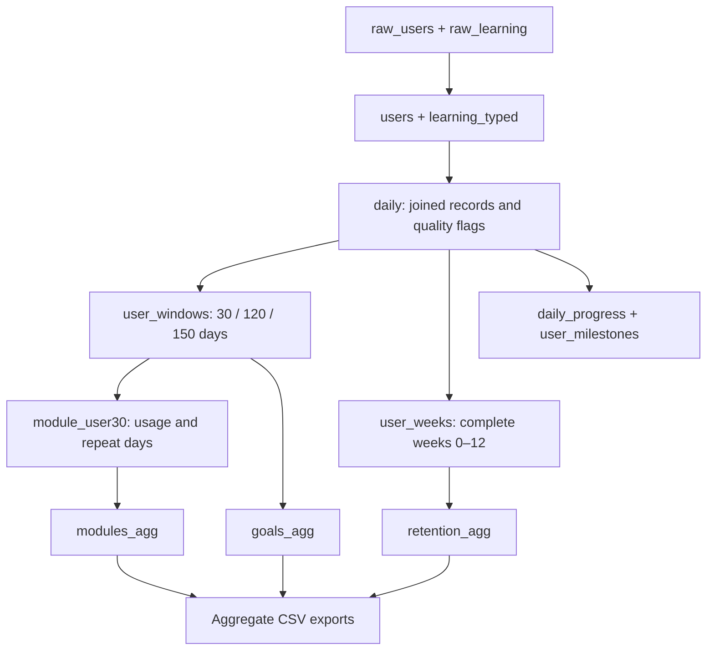

# SQL - From raw records to analytical tables

SQL queries for profiling and cleaning learner records, defining observation windows, and analyzing study targets, retention and module usage.

## Files and execution order

| File | Purpose |
| --- | --- |
| [00_import.sql](00_import.sql) | Read original CSVs; decode Windows-1258; explicitly name the duplicated date header; inspect source counts |
| [01_pipeline.sql](01_pipeline.sql) | Validate and type records; create quality flags; build user-window, user-week, module and milestone tables |
| [02_export.sql](02_export.sql) | Export aggregate CSVs and dimension tables to `data/processed` |
| [03_investigate.sql](03_investigate.sql) | Inspect quality issues, retention components, module usage, sensitivity and early-study associations |

Use a DuckDB SQL session from the repository root:

```text
.bail on
.read sql/00_import.sql
.read sql/01_pipeline.sql
.read sql/02_export.sql
.read sql/03_investigate.sql
```

Alternatively execute each file's contents in order in a DuckDB-compatible SQL editor using the same connection. Stop on any error. The `data/processed` directory must exist. Exports replace the corresponding aggregate CSVs.

The first import installs and loads DuckDB's `encodings` extension to read the original Windows-1258 user file. First installation needs access to the extension repository. The learning file is UTF-8. Keep both original source filenames under `data/raw` or edit their paths in `00_import.sql`.

**Dialect:** DuckDB (verified with 2.0.0).

## Analytical pipeline



## Cleaning and validation decisions

1. **Types and grain:** dates use month/day/year; time counters remain hours. `users` must have unique nonnull IDs; learning must have one row per user/date and valid foreign keys.
2. **Invalid measurements:** malformed dates, missing/nonfinite numbers and negative durations stop execution. They are not converted to zero.
3. **Questionable records:** flag pre-activation logs, post-expiry logs, logs before installation, days above eight hours, inconsistent date parts and module totals exceeding app time. These are investigation flags, not automatic deletion rules.
4. **Eligibility:** day 0 is activation. A 30-day window is days 0–29; week 8 is days 56–62. Retain inactive users through left joins, but exclude windows that extend beyond available observation.
5. **Missing activity:** zero-fill only absent activity aggregates for eligible users, under the complete-tracking assumption.
6. **Export:** retain all aggregate cells internally; exclude cohort/plan cells with fewer than ten eligible users from the three dashboard fact exports.

## SQL techniques demonstrated

- CTEs and layered tables to separate source, validation and analytical logic.
- Joins and conditional aggregation for target attainment and return behavior.
- `ROW_NUMBER` with date offsets to identify consecutive study-day streaks.
- `LAG` to measure gaps between observed dates.
- Cumulative `SUM ... OVER` to identify study-hour milestones.
- Calendar-window eligibility to avoid counting unobservable future activity as churn.
- Sensitivity queries that retain the original denominator when excluding flagged days.

## Output tables

`goals.csv`, `retention.csv` and `modules.csv` contain additive counts and hours at cohort/plan/period, cohort/plan/week and cohort/plan/module grain. Power BI derives rates from these counts within the current filter context.

`cohort.csv`, `plan.csv`, `period.csv`, `week.csv` and `module.csv` provide lookup dimensions. `goal_summary.csv` summarizes target attainment, while `fixed_retention.csv` tracks a fixed cohort across 13 weeks.

All user-level intermediate tables stay in the local SQL session. An in-memory session avoids creating a persistent database of individual records. Consult [metric definitions](../docs/METRICS.md) before interpreting or changing a calculation.
